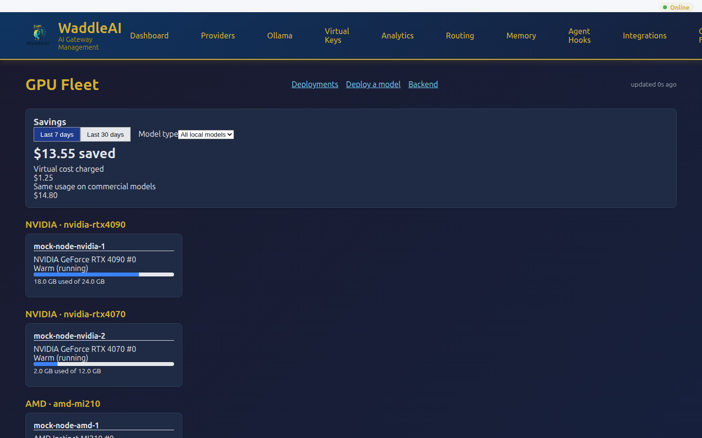
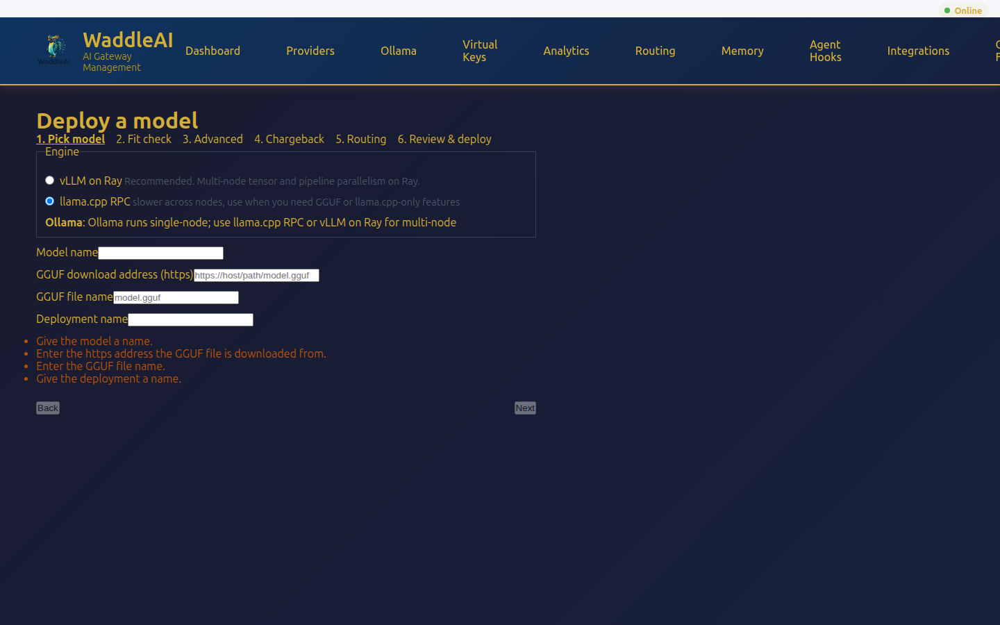
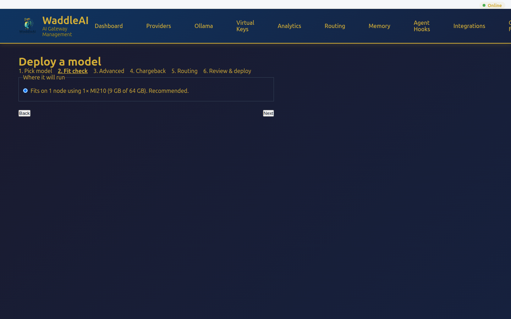
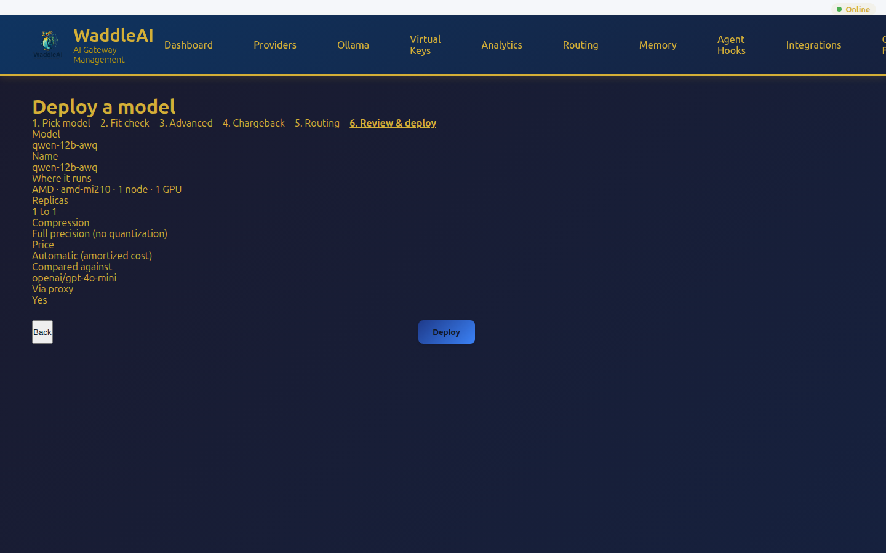
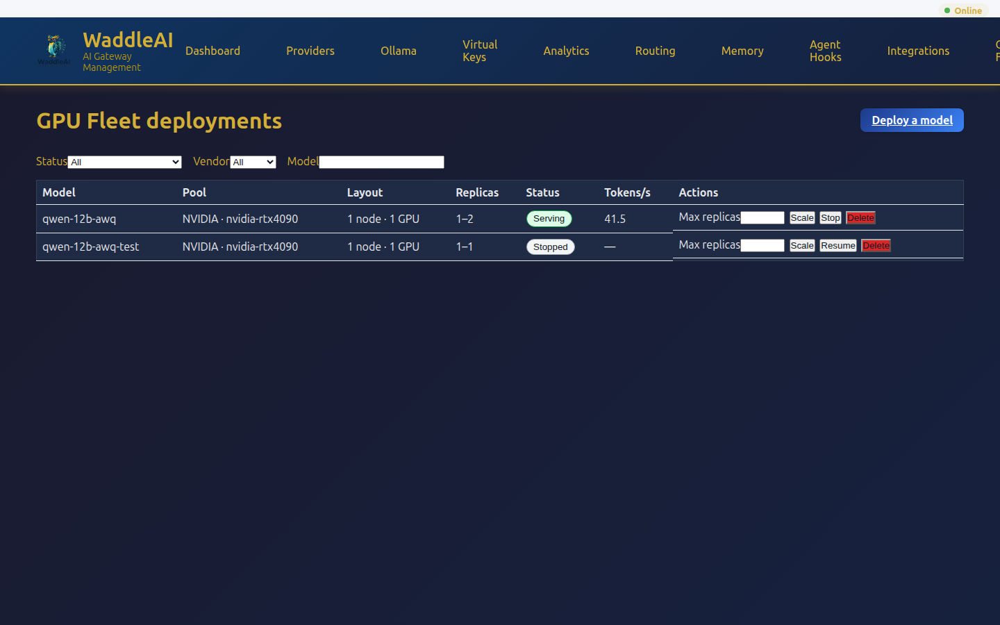
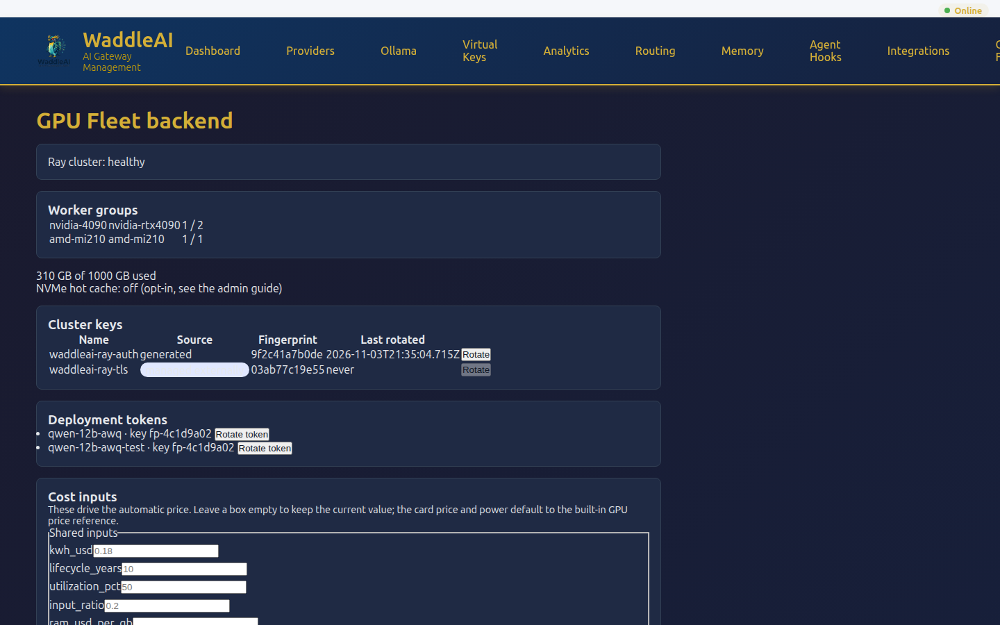

# GPU Fleet: vLLM on Ray

## What this does

The GPU Fleet runs open-weight models on your own GPU nodes (NVIDIA, AMD and Intel) and serves them
through the WaddleAI proxy like any other model. An admin picks a model in the web UI, WaddleAI
checks that it fits, and deploys it. Teams are charged a virtual price against their token budget,
and the savings against a commercial model are reported. The whole feature sits behind two flags.

API reference: `openapi/v1.yaml` (the `/api/v1/fleet/...` paths).

## Prerequisites

| Item | Detail |
|---|---|
| Node labels | `waddleai.penguintech.io/ai-node=true`, `waddleai.penguintech.io/gpu-vendor`, `waddleai.penguintech.io/gpu-classes` |
| Device plugin class map | `fleet.vllmRay.nvidiaClassMap` (maps device names to GPU classes) |
| Storage class | an RWX class for the shared model store |
| Flags | `waddleai.fleet_v2` and `waddleai.fleet-vllm-ray` (both default OFF; both must be ON) |

With either flag off the "GPU Fleet" menu entry is hidden and the API answers 404.

## Authentication & keys

- Every inference endpoint requires a per-deployment bearer token; the proxy is the only holder. `Rotate token` rotates it; clients using the old token stop working after about 2 minutes.
- Cluster keys: list with `waddleai fleet secrets list`; rotate with `waddleai fleet secrets rotate <name>` (restarts Ray head and workers). Values are never shown, only fingerprints and rotation times. Cluster keys are shared by every tenant, so only the platform operator can list or rotate them.
- `managed externally`: a key supplied by env var or `existingSecret` cannot be rotated from WaddleAI (409, CLI exit 2). Rotate it in your secret store.

| Key | Env var | `existingSecret` key | Precedence |
|---|---|---|---|
| Ray auth token | `WADDLEAI_RAY_AUTH_TOKEN` | `fleet.security.rayAuthToken.existingSecret` (key `token`) | env > existingSecret > chart-generated |
| Ray TLS | `WADDLEAI_RAY_TLS_CERT_PATH`, `WADDLEAI_RAY_TLS_KEY_PATH`, `WADDLEAI_RAY_TLS_CA_PATH` | `fleet.security.rayTls.existingSecret` (keys `tls.crt`, `tls.key`, `ca.crt`) | env > existingSecret > chart-generated |
| Connection-link encryption | `WADDLEAI_FLEET_TOKEN_ENCRYPTION_KEY` | `fleet.security.tokenEncryptionKey.existingSecret` (key `fernet`) | env > existingSecret > chart-generated |
| SPIFFE trust domain | `WADDLEAI_SPIFFE_TRUST_DOMAIN` (not a secret) | n/a | env > `fleet.security.spiffeTrustDomain` (default `penguintech.io`) |

Infisical: sync a secret to a Kubernetes Secret with the Infisical Kubernetes operator, then set
`fleet.security.rayAuthToken.existingSecret: ray-token-from-infisical`.

External Secrets Operator: an `ExternalSecret` with `target.name: ray-token-from-vault` and
`data: [{secretKey: token, remoteRef: {key: waddleai/ray, property: token}}]`, then set
`fleet.security.rayAuthToken.existingSecret: ray-token-from-vault`.

## Deploy walkthrough

Open **GPU Fleet** in the menu. The overview lists every GPU node and the savings card.

Choose **Deploy a model**. The wizard has six steps:

1. **Pick model**: choose the engine, then the model. **vLLM on Ray** is recommended (multi-node tensor and pipeline parallelism on Ray): pick a registry model or a HuggingFace repo id, and enter the parameter count if the registry does not know it; it is never guessed. **llama.cpp RPC** spreads one GGUF model over several nodes; it is slower across nodes, so use it when you need GGUF or llama.cpp-only features. For it, enter a model name, the https address the GGUF is downloaded from and the GGUF file name. **Ollama** is shown as a note only: it runs single-node, so use llama.cpp RPC or vLLM on Ray for multi-node.
2. **Fit check**: for vLLM, runs live as you change settings and shows where the model will run, or why it cannot. llama.cpp RPC has no preview: the server plans the split when you deploy and refuses with the reason if the model does not fit, fits on one node, or the cluster lacks Cilium mutual auth.
3. **Advanced**: for vLLM, data type, compression (only options the GPUs support), maximum context, replicas. For llama.cpp RPC, the GGUF file size in GB (sent as bytes, never guessed), maximum context, and whether different GPU models may share one deployment.
4. **Chargeback**: the automatic price with its breakdown, or a manual price; the commercial model to compare against.
5. **Routing**: make the model available through the proxy; optionally prefer it for requests whose model name starts with a prefix, with a commercial fallback. llama.cpp deployments are always exposed through the proxy with their own key, so this step only says so.
6. **Review & deploy**.

Manage running models on **Deployments**: scale, stop, resume, delete, and open the timeline by
clicking the status. Backend health, cluster keys, deployment tokens and cost inputs are on **Backend**.

## What "fits" means

A model fits when its weights plus the conversation cache fit in the GPU memory of a warm pool.
About 20% of GPU memory is kept free for the cache, and each GPU reserves about 1.5 GB of context
overhead. The answer is a plain sentence, for example `Fits on 1 node using 2× RTX 4090 (46 GB of 48 GB). Recommended.`
When it does not fit, the refusal says what would make it fit (more GPUs, 4-bit compression, more nodes).
The UI shows the server's text unchanged.

## Chargeback and savings

Every locally hosted model (vLLM, Ollama and llama.cpp) gets a virtual price per million tokens.
Automatic pricing amortizes card, power and server cost over the observed (else estimated) speed;
a manual price can be set at any time and affects new requests only. Teams using the model are
charged the virtual price against their token budget. The overview savings card compares the virtual
cost with the same usage on each deployment's comparison model, for 7 or 30 days, filterable by kind.

## Troubleshooting

| Symptom | Meaning | What to do |
|---|---|---|
| Queued | The deployment is waiting for the controller | Wait; if it stays, check the management logs |
| Downloading model | Weights are being pulled into the model store | Wait; check store capacity and the HuggingFace token for gated models |
| Starting engine | Ray is starting the engine | Wait; check Ray head and worker pods |
| Warming up | The engine is loading and compiling | Wait a few minutes |
| Serving | Healthy | Nothing |
| Degraded — see details | Serving with a problem (see the timeline) | Open the timeline; check GPU health and Ray |
| Stopped | Stopped by an admin | Use Resume |
| Failed | Deployment failed (see the timeline) | Read the last timeline message; fix and Resume |
| Warm (running) | GPU is in use or ready | Nothing |
| Cold (scaled to zero) | Node is scaled to zero | It wakes on demand |
| Unclassified — not schedulable | GPU class is unknown | Set the class map or `cost.cardUsd`/`tdpWatts`; label the node |
| Mixed GPUs in one node — not supported yet | One node has different GPU models | Use one GPU model per node |

## Command line

`waddleai fleet vllm inventory|fit|deploy|list|scale|stop|resume|delete|rotate-token` and
`waddleai fleet llamacpp deploy|list` (`deploy --topology rpc --model-url U --model-filename F
--gguf-bytes B` creates a multi-node llama.cpp deployment; a taken name or a running deployment
being converted is refused with 409) and `waddleai fleet secrets list|rotate`. Destructive commands need `--yes` in scripts. See
`clients/waddleai-cli/README.md`. Mock data for demos: `make seed-mock-data`.

## Scope limits

- Intel GPUs: single-GPU replicas; AMD and Intel are homogeneous per node.
- No training or fine-tuning; inference only.
- Non-WaddleAI GPU pods are unsupported on AI nodes.
- Ollama runs single-node; use llama.cpp RPC or vLLM on Ray for multi-node.
